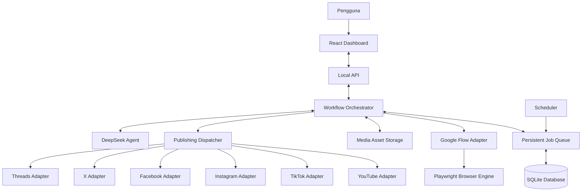
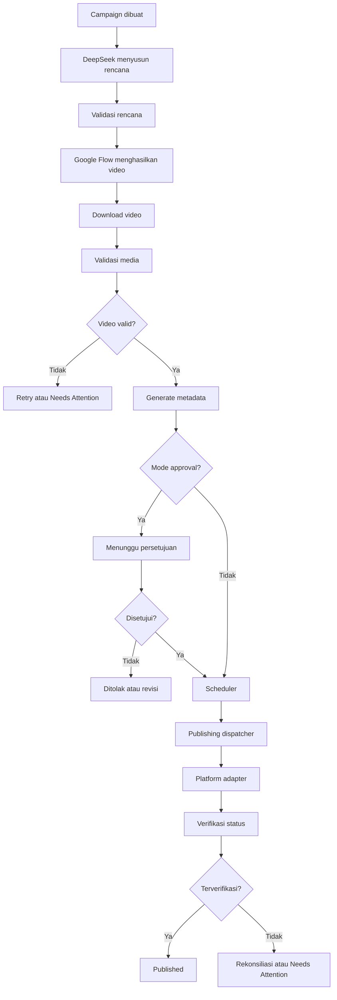

# High-Level Design (HLD)
## AI Social Media Automation Agent

**Versi:** 1.0  
**Status:** Draft untuk persetujuan arsitektur  
**Deployment:** Windows PC lokal  
**Platform target:** YouTube, TikTok, Instagram, Facebook, X, Threads  
**Stack:** React, TypeScript, Node.js, Playwright, DeepSeek, SQLite

---

## 1. Ringkasan Eksekutif

AI Social Media Automation Agent adalah aplikasi lokal yang mengotomatisasi produksi dan distribusi video dari perencanaan konten hingga publikasi. DeepSeek bertindak sebagai AI planner; Google Flow dikendalikan melalui Playwright untuk menghasilkan dan mengunduh video; kemudian adapter terpisah menangani publikasi ke tiap platform.

Sistem mendukung interval tetap dan acak, mode otomatis dan persetujuan manusia, antrean persisten, retry, idempotency, sesi browser aman, logging, audit, dan pemulihan setelah restart.

### 1.1 Tujuan

- Mengotomatisasi alur produksi video dari ide sampai publikasi.
- Mengurangi pekerjaan manual dalam distribusi lintas platform.
- Mengelola jadwal, kuota, akun, dan mode publikasi dari satu dashboard.
- Memastikan setiap proses dapat dipantau, dihentikan, dan dipulihkan.
- Menyediakan arsitektur modular yang dapat diperluas.

### 1.2 Prinsip desain

1. AI merencanakan; workflow engine mengontrol eksekusi.
2. Setiap platform diisolasi dalam adapter.
3. Semua job memiliki status dan riwayat persisten.
4. Publikasi tidak diulang sebelum status percobaan sebelumnya diperiksa.
5. Kredensial dan sesi browser diperlakukan sebagai data sensitif.
6. Tantangan keamanan yang memerlukan manusia menghentikan worker dengan aman.
7. Otomatisasi mengikuti izin, batas, dan kebijakan layanan.

## 2. Ruang Lingkup

### 2.1 Termasuk

- Dashboard dan konfigurasi aplikasi.
- Integrasi DeepSeek API dan perencanaan konten.
- Generasi video Google Flow melalui Playwright.
- Download dan validasi media.
- Caption dan metadata per platform.
- Scheduler fixed interval, random interval, dan random time window.
- Antrean job persisten.
- Mode automatic dan approval-required.
- Adapter YouTube, TikTok, Instagram, Facebook, X, dan Threads.
- Pengelolaan akun dan sesi browser.
- Retry, recovery, idempotency, logging, audit.
- Penyimpanan aset lokal.

### 2.2 Di luar ruang lingkup MVP

- Deployment cloud multi-tenant.
- Billing dan langganan.
- Marketplace kreator dan analitik lanjutan.
- Pelatihan model AI sendiri.
- Jaminan direct publishing sebelum akses dan kemampuan platform diverifikasi.
- Bypass CAPTCHA, security challenge, atau pembatasan layanan.

### 2.3 Asumsi

- Aplikasi digunakan oleh satu pengguna utama di Windows PC.
- PC harus aktif ketika worker lokal berjalan.
- Internet diperlukan untuk DeepSeek, Google Flow, dan publikasi.
- Pengguna berwenang mengelola akun yang dihubungkan.
- Google Flow browser automation rentan terhadap perubahan UI, autentikasi, wilayah, dan ketersediaan fitur.
- Kemampuan publikasi tiap platform diverifikasi secara terpisah.

## 3. Gambaran Arsitektur

### 3.1 Komponen

- **React Dashboard:** campaign, konten, approval, akun, scheduler, job monitor, konfigurasi.
- **Local API:** validasi input, otorisasi, endpoint UI, komunikasi dengan workflow.
- **Workflow Orchestrator:** lifecycle job, dependensi, status, timeout, retry, cancellation, recovery.
- **DeepSeek Agent:** perencanaan dan keputusan terstruktur melalui tool registry.
- **Scheduler:** waktu eksekusi berdasarkan interval, jendela, kuota, dan timezone.
- **Persistent Job Queue:** pekerjaan yang menunggu, berjalan, atau perlu diulang.
- **Google Flow Adapter:** generasi dan download via Playwright; tidak mengasumsikan API publik tersedia.
- **Publishing Dispatcher:** mengirim job ke adapter platform.
- **Media Storage:** video, metadata, checksum, status validasi.
- **SQLite:** konfigurasi, campaign, job, jadwal, status akun, publikasi, audit.

## 4. Keputusan Teknologi

| Area | Pilihan | Alasan |
|---|---|---|
| Frontend | React + TypeScript + Vite + Tailwind | Dashboard modular |
| Backend | Node.js + TypeScript + Fastify | API lokal dan workflow |
| Validasi | Zod | Request, payload, output AI |
| ORM | Drizzle ORM | Schema dan migrasi |
| Database | SQLite + WAL | Cocok untuk satu mesin |
| Queue | SQLite persistent queue untuk MVP | Mengurangi dependensi tambahan |
| Browser | Playwright Chromium | Browser automation |
| AI | DeepSeek API melalui provider adapter | Planner dan metadata |
| Media | FFmpeg/ffprobe | Validasi video |
| Logging | Pino | Structured logging |
| Testing | Vitest + Playwright Test | Unit, integration, E2E |
| Packaging | Electron atau Tauri | Dipilih setelah worker stabil |

Redis/BullMQ dapat ditambahkan jika kebutuhan concurrency dan antrean meningkat. Hindari dua sistem antrean yang menjadi sumber kebenaran untuk job yang sama.

## 5. Alur Bisnis

Tahapan: campaign → rencana AI → validasi → generasi → download → validasi media → metadata → approval bila diperlukan → scheduling → publikasi per platform → verifikasi → audit. Satu campaign dapat memiliki banyak publication job; kegagalan satu platform tidak otomatis menggagalkan yang lain.

## 6. Integrasi Platform

| Platform | Adapter utama | Hal yang perlu diverifikasi |
|---|---|---|
| YouTube | YouTube Data API | OAuth, quota, upload, status video |
| TikTok | Content Posting API | Scope, audit aplikasi, direct post/draft |
| Instagram | Instagram Graph API | Jenis akun, izin, format publishing |
| Facebook | Meta Graph API | Page access, izin, format video |
| X | X API | Tingkat akses, biaya, rate limit, media |
| Threads | Threads API | Izin, format, alur publikasi |

Prioritaskan API resmi yang tersedia dan sesuai. Playwright hanya menjadi fallback terbatas untuk interaksi UI yang diizinkan. Jika tindakan tidak didukung atau memerlukan verifikasi keamanan, minta intervensi pengguna.

Setiap adapter harus menyediakan `capabilities()`, `validate()`, `publish()`, dan `getStatus()`. Capability meliputi dukungan video, format, ukuran, caption, scheduling, privacy, metode publikasi, dan status autentikasi. Fitur yang belum diverifikasi harus diberi status `unknown` atau `unsupported`.

## 7. Workflow dan Reliability

### 7.1 Status job

`QUEUED`, `PLANNING`, `GENERATING`, `DOWNLOADING`, `VALIDATING`, `AWAITING_APPROVAL`, `SCHEDULED`, `PUBLISHING`, `VERIFYING`, `PUBLISHED`, `RETRY_WAIT`, `NEEDS_ATTENTION`, `FAILED`, `CANCELLED`.

Transisi status dikendalikan workflow engine. `PUBLISHED` hanya boleh diberikan jika ada bukti keberhasilan yang memadai.

### 7.2 Retry

| Kegagalan | Penanganan |
|---|---|
| Timeout jaringan sebelum aksi eksternal | Retry terbatas |
| HTTP 429 | Hormati `Retry-After` dan kuota |
| HTTP 5xx | Retry jika aman |
| Token kedaluwarsa | Minta autentikasi ulang |
| CAPTCHA/security challenge | Hentikan worker dan minta intervensi |
| File tidak valid | Validasi ulang atau perbaikan |
| Hasil publikasi ambigu | Rekonsiliasi sebelum retry |
| Job dibatalkan | Jangan memulai langkah berikutnya |

Batas awal: maksimal tiga retry untuk kegagalan sementara, dapat dikonfigurasi per adapter.

### 7.3 Idempotency

- Key unik untuk kombinasi aset, akun, platform, dan campaign.
- Simpan status `PUBLISHING` sebelum aksi eksternal.
- Simpan external post ID dan URL segera setelah tersedia.
- Jangan ulangi upload setelah timeout sebelum memeriksa status.
- Jika status tidak dapat dipastikan, gunakan `NEEDS_ATTENTION`.

Exactly-once tidak dapat dijamin bila platform tidak menyediakan idempotency yang sesuai.

## 8. Scheduler

Scheduler mendukung interval tetap, interval acak, waktu acak dalam jendela harian, kuota per akun/platform, quiet hours, jadwal manual, pause, dan resume.

Aturan:
- Zona waktu default `Asia/Jakarta`.
- `next_run_at` disimpan persisten.
- Restart tidak mengacak ulang jadwal yang sudah tersimpan.
- Kuota diperiksa sebelum publikasi.
- Pause menghentikan dispatch job baru, bukan menghapus jadwal.
- Interval acak untuk pengaturan waktu dan beban, bukan menghindari kebijakan anti-spam.

## 9. Keamanan

### 9.1 Secret dan sesi

- Simpan API key dan OAuth token melalui Windows Credential Manager atau DPAPI.
- Database menyimpan referensi secret, bukan token mentah.
- Pisahkan profil browser Google Flow dan setiap akun sosial media.
- Jangan masukkan cookie, profil browser, atau storage state ke Git.
- Redaksi secret di log dan error.

### 9.2 Local API

- Bind ke loopback secara default.
- Terapkan autentikasi lokal, validasi origin, dan pembatasan request.
- Batasi akses file ke direktori storage yang diizinkan.
- Jangan membuka port debugging browser ke jaringan.
- Jangan mengeksekusi shell command arbitrer dari AI.

### 9.3 Audit

Catat campaign ID, content ID, checksum aset, account ID, platform, job ID, waktu, hasil, external post ID bila tersedia, dan error code.

## 10. Deployment dan Lifecycle

### Startup

1. Muat konfigurasi.
2. Buka database dan jalankan migrasi.
3. Periksa job/lease kedaluwarsa.
4. Pulihkan antrean.
5. Aktifkan scheduler.
6. Jalankan Local API dan dashboard.
7. Tampilkan status worker dan integrasi.

### Shutdown

1. Hentikan penerimaan job baru.
2. Hentikan scheduler.
3. Selesaikan atau tandai job agar dapat dipulihkan.
4. Tutup browser dengan aman.
5. Simpan status dan log.
6. Tutup database.

Job yang terputus tidak boleh langsung dianggap gagal permanen tanpa rekonsiliasi.

## 11. Non-Functional Requirements

- **Reliability:** job persisten, recovery, isolasi kegagalan antarplatform.
- **Security:** secret terlindungi, sesi terisolasi, endpoint lokal dibatasi.
- **Maintainability:** adapter independen, domain tidak bergantung pada selector browser, migrasi dan tes.
- **Observability:** structured logs, timeline job, durasi, status worker.
- **Performance:** dashboard real-time, concurrency browser dapat diatur, satu job per profil pada satu waktu.

## 12. Acceptance Criteria

1. Aplikasi berjalan di Windows dengan database persisten.
2. DeepSeek menghasilkan rencana tervalidasi.
3. Google Flow adapter menjalankan alur browser yang diuji dan mengunduh video saat fitur tersedia.
4. Media rusak ditolak.
5. Scheduler mematuhi interval, window, dan kuota.
6. Approval mencegah publikasi sebelum disetujui.
7. Setiap platform diuji independen.
8. Retry tidak mengulang publikasi ambigu tanpa rekonsiliasi.
9. Restart tidak menghilangkan job atau jadwal.
10. Secret tidak muncul dalam repository/log.
11. Dashboard menampilkan status dan error.
12. Kill switch menghentikan job baru.
13. `PUBLISHED` memerlukan bukti.
14. Minimal satu alur end-to-end berhasil pada adapter berizin.

## 13. Roadmap

1. **Core foundation:** monorepo, database, queue, state machine, scheduler, logging, dashboard.
2. **AI dan Google Flow:** planner, tool registry, Playwright, download, validasi, approval.
3. **Adapter pertama:** YouTube API, OAuth, upload, verifikasi.
4. **Multi-platform:** adapter lain sesuai akses dan izin.
5. **Hardening:** recovery, security review, packaging, backup, acceptance tests.

## 14. Keputusan Arsitektur

- Modular monolith dengan worker terisolasi.
- TypeScript strict mode.
- React + Vite, Node.js + Fastify.
- SQLite dan persistent queue untuk MVP.
- Playwright untuk browser automation.
- DeepSeek API sebagai planner.
- Google Flow melalui browser adapter tanpa asumsi API publik.
- API resmi sebagai prioritas publikasi.
- Scheduler persisten dengan interval acak.
- Windows Credential Manager/DPAPI.
- Retry terbatas, idempotency, reconciliation, audit, dan recovery.

## 15. Penutup

HLD ini menjadi baseline arsitektur. Detail yang bergantung pada layanan eksternal harus diverifikasi melalui dokumentasi resmi dan pengujian integrasi sebelum dianggap siap produksi. LLD melengkapi HLD dengan struktur package, schema, kontrak API, state machine, retry, security controls, dan acceptance tests.
