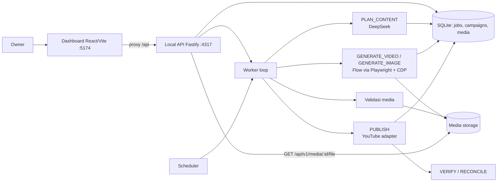

# AI Social Media Automation Agent

Aplikasi desktop lokal (Windows) untuk mengotomatisasi alur produksi konten media sosial: perencanaan oleh DeepSeek, produksi video/gambar lewat Google Flow, validasi media, penjadwalan, dan publikasi ke platform — dengan antrean job persisten, gerbang approval, retry, rekonsiliasi, dan audit.

> **Status proyek:** seluruh lapisan berjalan end-to-end di mode mock. Adapter YouTube Data API v3 sudah terpasang dan teruji dengan HTTP palsu, tetapi **belum ada unggahan nyata yang terverifikasi** (P5 PARTIAL). Mode gambar baru sampai produksi media; publikasi gambar belum ada adapternya.

## Daftar Isi

- [Fitur](#fitur)
- [Arsitektur](#arsitektur)
- [Struktur Repo](#struktur-repo)
- [Prasyarat](#prasyarat)
- [Instalasi & Menjalankan](#instalasi--menjalankan)
- [Konfigurasi](#konfigurasi)
- [Alur Pemakaian](#alur-pemakaian)
- [API](#api)
- [Database](#database)
- [Testing & Quality Gate](#testing--quality-gate)
- [Keamanan](#keamanan)
- [Batasan Saat Ini](#batasan-saat-ini)
- [Dokumentasi](#dokumentasi)

## Fitur

| Area | Yang tersedia |
|---|---|
| Campaign | Mode generasi `video`/`image`, mode approval `automatic`/`required`, platform target, niche |
| Perencanaan | Planner DeepSeek dengan skema Zod, output batch `items[]`, tool allowlist (tanpa shell/eval) |
| Approval | Keputusan per rencana (approve/reject) dan per konten, dengan binding `version`/`assetSha256`/`captionHash`/`accountId`/`platform` |
| Produksi media | Generator `mock` (MP4/PNG valid) atau Google Flow nyata via Chrome + CDP; validasi signature MP4/PNG/JPEG, probe durasi video, containment path `MEDIA_ROOT` |
| Antrean job | 10 tipe job, 15 status, retry backoff + jitter, recovery setelah restart, event log per job |
| Penjadwalan | Zona waktu `Asia/Jakarta`, window acak, quiet hours, kuota harian, pause/resume |
| Publikasi | Adapter YouTube `mock` dan `api` (Data API v3 + verifikasi privasi via `videos.list`, resume HTTP 308) |
| Dashboard | React 18: Overview, Campaigns, Jobs (pratinjau + unduh hasil), Approvals, Connections, Accounts |
| Operasional | CLI preflight YouTube, pairing OAuth, login sesi Flow, inspeksi/generate Flow manual |
| Keamanan | Bind loopback, redaksi log, kredensial di DPAPI, tanpa bypass CAPTCHA |

## Arsitektur



Prinsip yang mengikat:

1. AI merencanakan, workflow engine yang mengontrol eksekusi.
2. Setiap platform diisolasi dalam adapter (`SocialAdapter`).
3. Semua job punya status dan riwayat persisten di SQLite.
4. Publikasi tidak diulang sebelum status percobaan sebelumnya diperiksa.
5. Kredensial dan sesi browser adalah data sensitif.
6. Tantangan keamanan yang butuh manusia menghentikan worker secara aman sebagai `NEEDS_ATTENTION` — tidak pernah di-bypass.

Arah dependensi: `domain` tidak mengimpor adapter/UI; adapter mengimplementasikan interface domain; workflow bergantung pada interface, bukan detail vendor.

## Struktur Repo

```text
apps/local-api            Fastify + composition root: 32 endpoint, worker loop, scheduler, CLI operasional
apps/dashboard            React 18 + Vite 6, proxy /api ke Local API (tanpa akses DB langsung)

packages/domain           Entitas, JobType/JobStatus, state machine, kontrak SocialAdapter, mode generasi
packages/database         Skema Drizzle (13 tabel), migrasi SQL 0000–0004, repository
packages/workflow         Dispatcher, worker, retry, handler PLAN_CONTENT / GENERATE_* / PUBLISH
packages/agent-core       Skema rencana, planner, adapter DeepSeek, tool allowlist
packages/scheduler        Zona waktu, window/quiet hours, kuota harian, enqueuer PUBLISH
packages/browser-engine   Kontrak MediaGenerator, generator mock/Flow, validasi media, lock profil
packages/youtube          Adapter YouTube mock + Data API v3, OAuth client, credential store DPAPI
packages/observability    Logger Pino + redaksi secret

tests/integration         Migrasi, recovery restart, klaim job lintas koneksi, envelope API
docs/                     Runbook operasional dan status kontrol keamanan
knowledge/                Knowledge base proyek: ADR, modul, log sesi, state mesin
HLD.md / LLD.md           Dokumen desain tingkat tinggi dan rendah
```

## Prasyarat

| Item | Nilai |
|---|---|
| Node.js | `>=22.12 <23` (lihat `engines` di `package.json`) |
| pnpm | 9.15.4 lewat `corepack` — jangan memasang pnpm global |
| OS | Windows 10/11 (token YouTube memakai DPAPI user-scope) |
| Browser | Chrome/Edge/Chromium terpasang — hanya untuk mode Flow nyata (`FLOW_ADAPTER=real`) |
| Akun DeepSeek | Untuk `PLAN_CONTENT`; kunci diisi lewat halaman Connections (DPAPI) atau `DEEPSEEK_API_KEY` |

Aplikasi **tidak** membaca berkas `.env`. Semua konfigurasi berasal dari environment variable sesi shell (atau *User environment variables* Windows).

## Instalasi & Menjalankan

Jalankan dari root repo:

```bash
corepack enable
corepack pnpm install
corepack pnpm migrate        # buat/selaraskan SQLite di ./data/database/app.sqlite

corepack pnpm start          # Local API -> http://127.0.0.1:4317
corepack pnpm ui             # Dashboard -> http://localhost:5174
```

Default aman untuk mencoba alur tanpa biaya: `FLOW_ADAPTER=mock`, `YOUTUBE_ADAPTER=off`. Untuk demo publikasi tanpa menyentuh YouTube nyata, gunakan `YOUTUBE_ADAPTER=mock`.

Perintah lain:

| Tujuan | Perintah |
|---|---|
| Mode watch API | `corepack pnpm dev` |
| Build dashboard | `corepack pnpm --filter @saa/dashboard build` |
| Cek kesiapan YouTube | `corepack pnpm --filter @saa/local-api preflight:youtube` |
| Pairing akun YouTube | `corepack pnpm --filter @saa/local-api pair:youtube --label "YouTube Utama"` |
| Login sesi Google Flow | `corepack pnpm --filter @saa/local-api flow:login` (`--check` untuk cek tanpa jendela) |

Catatan CLI: argumen diteruskan tanpa pemisah `--`, mis. `pnpm run <script> --label "x"`.

## Konfigurasi

| Variabel | Default | Rahasia | Catatan |
|---|---|---|---|
| `APP_ENV` | `development` | — | `development` · `test` · `production` |
| `APP_HOST` | `127.0.0.1` | — | Host non-loopback ditolak kecuali `APP_ALLOW_NETWORK=true` |
| `APP_PORT` | `4317` | — | |
| `APP_TIMEZONE` | `Asia/Jakarta` | — | Zona waktu scheduler |
| `DATABASE_PATH` | `./data/database/app.sqlite` | — | Relatif terhadap root repo |
| `MEDIA_ROOT` | `./data/media` | — | Root penyimpanan aset media |
| `LOG_LEVEL` | `info` | — | Level Pino |
| `JOB_MAX_ATTEMPTS` | `3` | — | Retry maksimum per job |
| `WORKER_ENABLED` / `WORKER_INTERVAL_MS` | `true` / `1000` | — | Loop worker |
| `SCHEDULER_ENABLED` / `SCHEDULER_INTERVAL_MS` | `true` / `5000` | — | Dispatch jadwal menjadi job `PUBLISH` |
| `YOUTUBE_ADAPTER` | `off` | — | `off` · `mock` · `api` |
| `YOUTUBE_UPLOAD_PRIVACY` | `private` | — | Privasi default; hasilnya diverifikasi `videos.list` |
| `YOUTUBE_APP_STATUS` | `unknown` | — | `production` · `testing` · `unknown`; `testing` dilarang (refresh token 7 hari) |
| `FLOW_ADAPTER` | `mock` | — | `mock` (artefak palsu) · `real` (Google Flow via CDP) |
| `FLOW_CDP_ENDPOINT` | `http://127.0.0.1:9222` | — | Wajib loopback |
| `FLOW_BROWSER_CHANNEL` | deteksi otomatis | — | `chrome` · `msedge` · `chromium` |
| `APP_ALLOW_NETWORK` | `false` | — | Pembuka bind non-loopback secara eksplisit |
| `DEEPSEEK_API_KEY` | — | ya | Fallback; kunci dari UI (DPAPI) menang. Tanpa keduanya job `PLAN_CONTENT` berakhir `AUTH` |
| `GOOGLE_OAUTH_CLIENT_ID` | — | ya | Wajib untuk pairing dan adapter `api` |
| `GOOGLE_OAUTH_CLIENT_SECRET` | — | ya (opsional) | Opsional untuk OAuth client tipe Desktop |

Rahasia **tidak boleh** ditulis ke berkas repo, log, `knowledge/`, `state.json`, atau chat:

- Kunci DeepSeek diisi owner sendiri di halaman **Connections** dan disimpan sebagai blob DPAPI `%LOCALAPPDATA%\saa\credentials\deepseek-api-key.bin`.
- Refresh token YouTube disimpan di `%LOCALAPPDATA%\saa\credentials\youtube-<accountId>.bin` (DPAPI user-scope); database hanya menyimpan `secret_ref`.

## Alur Pemakaian

1. Buka **Connections**, simpan kunci DeepSeek (opsional: pair akun YouTube, login sesi Flow).
2. Buat **campaign** di halaman Campaigns: niche, mode generasi (`video`/`image`), mode approval, platform.
3. Kirim permintaan rencana; worker `PLAN_CONTENT` memanggil DeepSeek dan menyimpan `items[]` sebagai rencana.
4. Tinjau rencana di panel Campaigns, lalu approve/reject per item.
5. Item yang disetujui menjadi job `GENERATE_VIDEO`/`GENERATE_IMAGE`; media divalidasi lalu disimpan.
6. Pantau job di halaman **Jobs** — detail job menampilkan pratinjau dan tombol unduh berkas hasil generasi.
7. Scheduler membuat job `PUBLISH` saat slot jatuh tempo (campaign `required` menunggu approval konten dulu), lalu adapter platform memverifikasi hasil publikasi.

## API

Local API menyediakan **32 endpoint** di bawah `/api/v1` (semuanya loopback):

| Grup | Endpoint |
|---|---|
| Health | `GET /health`, `GET /api/v1/health` |
| Dashboard | `GET /api/v1/dashboard/summary` |
| Campaigns | `GET/POST /api/v1/campaigns`, `GET /api/v1/campaigns/:id` |
| Rencana | `GET /api/v1/plans/:jobId`, `POST /api/v1/plans/:jobId/approve`, `POST /api/v1/plans/:jobId/reject` |
| Konten | `POST /api/v1/content`, `GET /api/v1/content/:id`, `POST /api/v1/content/:id/approve`, `POST /api/v1/content/:id/reject` |
| Jobs | `GET /api/v1/jobs`, `GET /api/v1/jobs/:id`, `GET /api/v1/jobs/:id/events`, `POST /api/v1/jobs/:id/retry`, `POST /api/v1/jobs/:id/cancel` |
| Media | `GET /api/v1/media/:id/file` (inline, allowlist mime, `x-media-sha256`) |
| Jadwal | `GET/POST /api/v1/schedules`, `PATCH /api/v1/schedules/:id` |
| Scheduler | `POST /api/v1/scheduler/pause`, `POST /api/v1/scheduler/resume` |
| Akun | `GET /api/v1/accounts` |
| Koneksi | `GET /api/v1/connections`, `GET /api/v1/connections/actions`, `POST /api/v1/connections/actions/:kind/stop`, `POST /api/v1/connections/flow/login`, `POST /api/v1/connections/youtube/pair` |
| Kredensial AI | `GET /api/v1/ai/status`, `POST /api/v1/ai/credentials` |

Respons galat memakai envelope konsisten: `{ error: { code, message, requestId, details? } }`.

## Database

SQLite dengan Drizzle ORM, WAL, `foreign_keys ON`, dan migrasi bernomor (`packages/database/migrations/0000`–`0004`). **13 tabel**: `settings`, `campaigns`, `social_accounts`, `content_items`, `media_assets`, `jobs`, `job_dependencies`, `schedules`, `approvals`, `plan_approvals`, `publish_attempts`, `audit_logs`, `schema_migrations`.

Waktu di database disimpan UTC ISO-8601; perhitungan jadwal memakai zona waktu `APP_TIMEZONE`.

## Testing & Quality Gate

```bash
corepack pnpm typecheck      # 10 paket + tests/tsconfig.json
corepack pnpm test           # Vitest
```

Hasil terakhir yang terverifikasi (commit `4ebdc9d`): `typecheck` exit 0 dan **506 test / 58 berkas** hijau. Jalankan dengan `--no-file-parallelism` bila SQLite uji saling mengganggu:

```bash
corepack pnpm vitest run --no-file-parallelism
```

## Keamanan

- Local API bind loopback; host non-loopback ditolak kecuali `APP_ALLOW_NETWORK=true`.
- Rahasia hanya lewat environment atau DPAPI; log diredaksi (`authorization`, `cookie`, `*.token`, `*.secret`, `*.password`).
- Tool AI berbasis allowlist, tanpa shell/eval.
- Path media divalidasi ulang terhadap `MEDIA_ROOT` saat divalidasi dan saat disajikan; hanya mime `video/mp4`, `image/png`, `image/jpeg` yang dilayani.
- Tidak ada upaya menembus CAPTCHA/anti-bot/login: kondisi itu menghentikan job sebagai `NEEDS_ATTENTION`.
- `.gitignore` menutup `data/`, `*.sqlite*`, `.env*`, storage state, dan cookies.

Status kontrol dan celah yang masih terbuka (antara lain autentikasi token Local API dan rate limit — P7) dicatat di [`docs/security.md`](docs/security.md).

## Batasan Saat Ini

- **Publikasi nyata belum terverifikasi.** Adapter YouTube `api` terpasang, tetapi bukti unggahan nyata masih menunggu kredensial Google Cloud/OAuth dari owner.
- **Mode gambar hanya produksi.** Belum ada adapter publikasi gambar; campaign gambar berhenti setelah media divalidasi.
- **Flow nyata butuh kredit Google.** Uji ulang unduhan video lewat Flow nyata dan uji tab Gambar Flow belum dijalankan karena memakai kuota berbayar.
- **Belum ada packaging desktop** (Electron/Tauri) dan belum ada edit/hapus campaign dari UI.
- Autentikasi token Local API, rate limit, dan batas body eksplisit belum ada (P7).

## Dokumentasi

| Dokumen | Isi |
|---|---|
| [`HLD.md`](HLD.md) / [`LLD.md`](LLD.md) | Desain tingkat tinggi dan rendah |
| [`docs/runbook.md`](docs/runbook.md) | Operasional: menjalankan, smoke, troubleshooting, pemulihan |
| [`docs/security.md`](docs/security.md) | Status kontrol keamanan dan prosedur insiden |
| [`knowledge/00_INDEX.md`](knowledge/00_INDEX.md) | Indeks knowledge base |
| [`knowledge/decisions/`](knowledge/decisions) | ADR-0001 … ADR-0012 (keputusan arsitektur) |
| [`knowledge/tasks/CURRENT.md`](knowledge/tasks/CURRENT.md) | Task aktif, temuan yang mengikat, handoff |
| [`AGENTS.md`](AGENTS.md) | Protokol kerja agen (AGY-QODER OS v4.3) |

## Lisensi

Belum ada lisensi yang ditetapkan untuk repositori ini.
